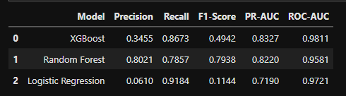
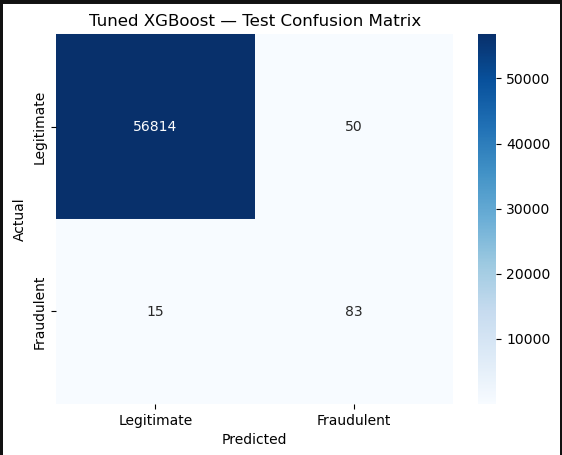
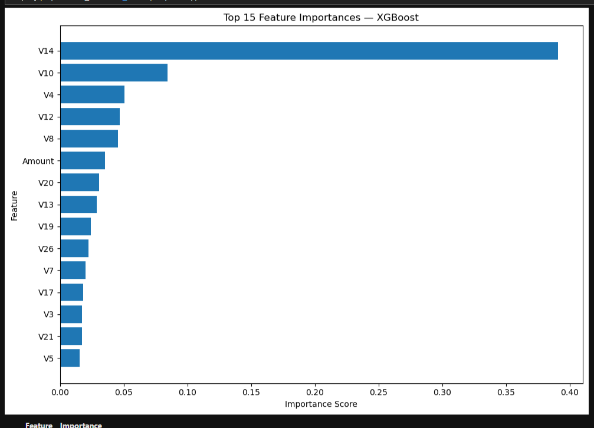

# Real-Time Fraud Anomaly Detection

A machine learning project that identifies potentially fraudulent credit card transactions using classification models and threshold tuning.

## Overview

Credit card fraud detection is challenging because fraudulent transactions represent a very small proportion of all transactions. This project explores machine learning techniques to distinguish legitimate transactions from potentially fraudulent ones.

## Objectives

- Explore and analyze transaction data.
- Train and compare multiple classification algorithms.
- Evaluate models using precision, recall, F1-score, PR-AUC, and ROC-AUC.
- Tune the classification threshold to balance fraud detection and false alarms.
- Save the selected model for reuse in predictions.

## Technologies Used

- Python
- Jupyter Notebook
- Pandas and NumPy
- Matplotlib and Seaborn
- Scikit-learn
- XGBoost
- Joblib

## Machine Learning Models

1. Logistic Regression
2. Random Forest
3. XGBoost

## Model Evaluation

The models were evaluated using precision, recall, F1-score, Precision-Recall AUC (PR-AUC), and ROC-AUC.

| Model | Precision | Recall | F1-Score | PR-AUC | ROC-AUC |
|---|---:|---:|---:|---:|---:|
| XGBoost | 0.3455 | 0.8673 | 0.4942 | 0.8327 | 0.9811 |
| Random Forest | 0.8021 | 0.7857 | 0.7938 | 0.8220 | 0.9581 |
| Logistic Regression | 0.0610 | 0.9184 | 0.1144 | 0.7190 | 0.9721 |

These values are from the earlier model comparison. Threshold-tuned XGBoost was subsequently evaluated separately in the notebook.

## Key Features

- Exploratory data analysis and visualizations.
- Imbalanced-class classification.
- Validation-based decision threshold selection.
- Confusion matrix and model evaluation.
- Feature-importance visualization.
- Reusable prediction function and batch predictions.
- Saved model and decision threshold.

## Project Structure

```text
Real-Time-Fraud-Anomaly-Detection/
├── 01_Fraud_Detection_Cleaned.ipynb
├── fraud_model_comparison.csv
├── models/                       # Generated locally
├── creditcard.csv                # Download separately
├── .gitignore
└── README.md
```

## Getting Started

1. Clone this repository.
2. Create and activate a Python virtual environment.
3. Install the required libraries.
4. Obtain `creditcard.csv` from the original dataset source and place it beside the notebook.
5. Open `01_Fraud_Detection_Cleaned.ipynb` in Jupyter Notebook.
6. Run the cells in order to reproduce the analysis and model training.

Install the main dependencies:

```bash
pip install pandas numpy matplotlib seaborn scikit-learn xgboost imbalanced-learn joblib jupyter
```

The trained model files are excluded from Git. Run the notebook's training and saving cells to generate them locally.

## Limitations

- The project uses historical transaction data.
- The model may not generalize to new fraud patterns without monitoring and retraining.
- False positives can affect legitimate customers.
- Live transaction streaming and production payment-system integration are not implemented.

## Future Enhancements

- Build an interactive fraud monitoring dashboard.
- Integrate a live or simulated transaction stream.
- Monitor model performance and data drift.
- Evaluate probability calibration and operational cost-based thresholds.
- Validate performance on a fresh, independent dataset.

## Disclaimer

This is an educational machine learning prototype, not a production-ready payment fraud prevention system.


## Screenshots

### Model Comparison


### Fraud Detection Confusion Matrix


### Feature Importance

